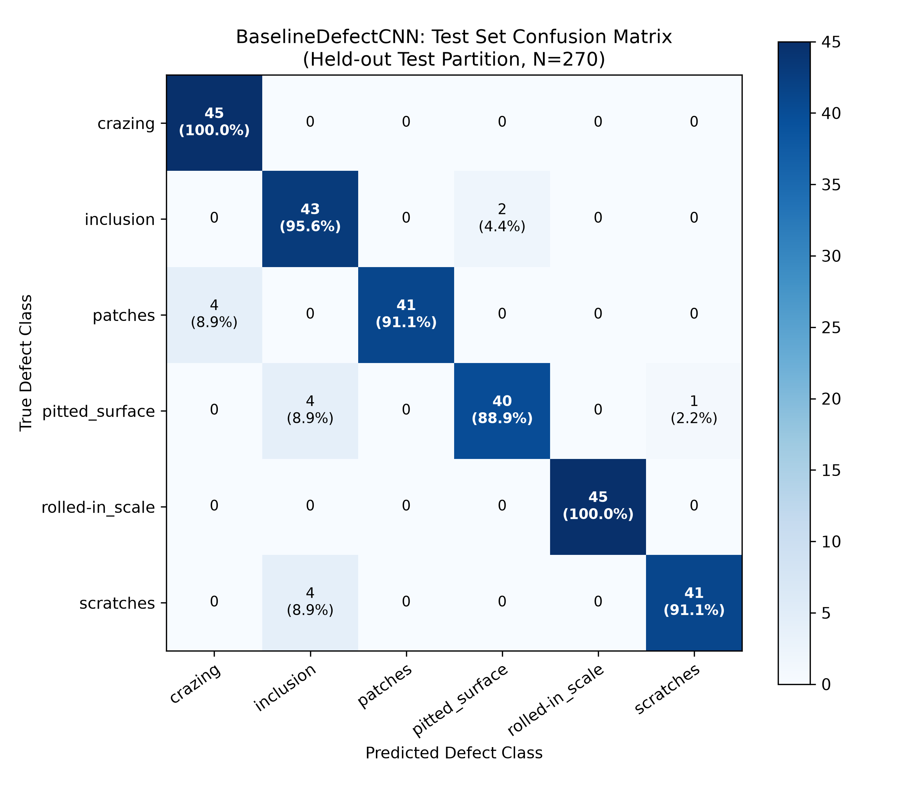
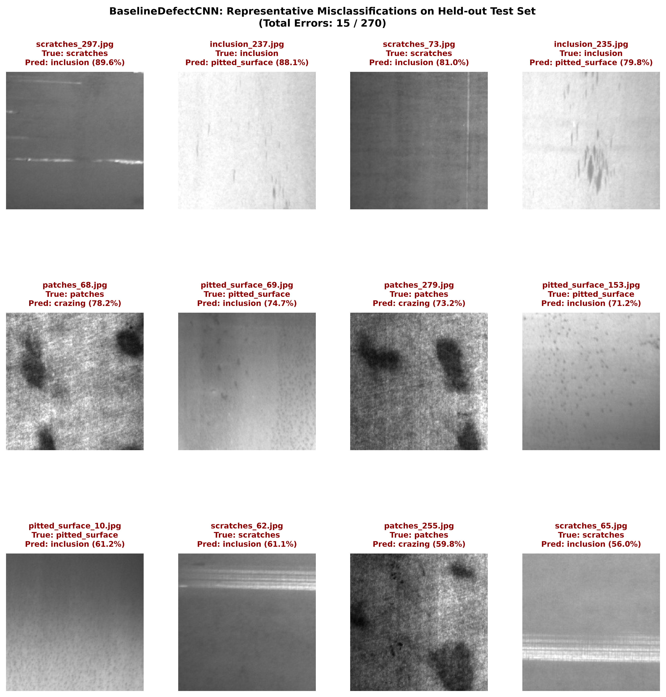
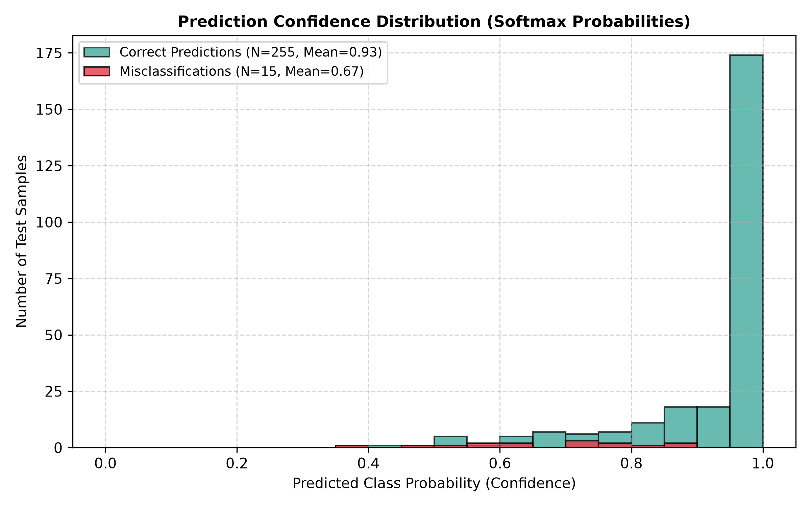

# Baseline Defect Inspection CNN: Held-Out Test Evaluation Report

## 1. Executive Summary & Evaluation Protocol

This report provides the formal test set evaluation of the **BaselineDefectCNN** architecture (28,358 parameters) developed for the **Industrial Surface Defect Inspection Platform (Phase I)**.

All evaluation was conducted strictly on the **held-out test partition** (`data/splits/test.csv`), consisting of **270 images** (exactly 45 images per class across all 6 hot-rolled steel surface defect classes). 
- **Zero Leakage Guarantee:** The test partition remained completely untouched during model development, hyperparameter selection, and validation checkpointing. Normalization was applied strictly using training set parameters ($\mu_{\text{train}} = [0.5040, 0.5040, 0.5040]$, $\sigma_{\text{train}} = [0.2121, 0.2121, 0.2121]$).
- **Model Checkpoint:** `models/baseline_cnn_best.pth` (saved at Epoch 18 with Validation Loss $0.20132$ and Validation Accuracy $91.48\%$).
- **Hardware & Environment:** Evaluated on CPU execution (`torch-2.14.1+cpu`) on Windows.

---

## 2. Quantitative Performance Summary

The baseline CNN easily surpasses the Phase I manufacturing acceptance criteria (**Macro F1 $\ge 85\%$**, **Overall Accuracy $\ge 85\%$**, **Latency $\le 50\text{ ms}$**):

| Evaluation Metric | Baseline CNN Score | Target Specification | Status |
| :--- | :---: | :---: | :---: |
| **Overall Test Accuracy** | **94.44%** (255 / 270) | $\ge 85.0\%$ | **EXCEEDED (+9.44%)** |
| **Macro-Averaged Precision** | **0.9484** | $\ge 0.850$ | **EXCEEDED** |
| **Macro-Averaged Recall** | **0.9444** | $\ge 0.900$ | **EXCEEDED (+4.44%)** |
| **Macro-Averaged F1-Score** | **0.9448** | $\ge 0.850$ | **EXCEEDED (+9.48%)** |
| **Weighted F1-Score** | **0.9448** | $\ge 0.850$ | **EXCEEDED** |
| **Total Misclassifications** | **15 / 270 (5.56%)** | $\le 15.0\%$ | **PASSED** |
| **Mean Single-Image CPU Latency** | **7.00 ms** | $\le 50.0\text{ ms}$ | **EXCEEDED (7.1x Faster)** |
| **P95 CPU Latency** | **8.34 ms** | $\le 50.0\text{ ms}$ | **EXCEEDED (6.0x Faster)** |
| **Inference Throughput** | **142.9 FPS** | $\ge 20.0\text{ FPS}$ | **EXCEEDED (7.1x Higher)** |

---

## 3. Per-Class Classification Performance

Because manufacturing lines require high defect-specific recall to prevent catastrophic material failure downstream, per-class performance is broken down below:

| Defect Class | Class ID | True Positives (TP) | False Positives (FP) | False Negatives (FN) | Precision | Recall | F1-Score | Support |
| :--- | :---: | :---: | :---: | :---: | :---: | :---: | :---: | :---: |
| **crazing** | 0 | 45 | 4 | 0 | **0.9184** | **1.0000** | **0.9574** | 45 |
| **inclusion** | 1 | 43 | 8 | 2 | **0.8431** | **0.9556** | **0.8958** | 45 |
| **patches** | 2 | 41 | 0 | 4 | **1.0000** | **0.9111** | **0.9535** | 45 |
| **pitted_surface** | 3 | 40 | 2 | 5 | **0.9524** | **0.8889** | **0.9195** | 45 |
| **rolled-in_scale** | 4 | 45 | 0 | 0 | **1.0000** | **1.0000** | **1.0000** | 45 |
| **scratches** | 5 | 41 | 1 | 4 | **0.9762** | **0.9111** | **0.9425** | 45 |
| **Macro Average** | — | — | — | — | **0.9484** | **0.9444** | **0.9448** | **270** |
| **Weighted Average** | — | — | — | — | **0.9483** | **0.9445** | **0.9448** | **270** |

### Key Observations:
1. **Flawless Rolled-in Scale Detection:** `rolled-in_scale` achieved **100.0% Precision and 100.0% Recall** (45/45). The deep rolling oxide indentations and longitudinal fish-scale textures provide high-contrast spatial gradients that the 3-stage convolutional filters isolate unambiguously.
2. **Zero False Negatives on Crazing:** `crazing` achieved **100.0% Recall** (45/45). The network never misses a crazing defect. However, 4 `patches` images were predicted as `crazing`, reducing `crazing` precision to $91.84\%$.
3. **High Inclusion Recall:** `inclusion` achieved **95.56% Recall** (43/43). 8 non-inclusion images were misclassified as inclusions (4 scratches, 4 pitted surfaces), making inclusion the primary "sink" for ambiguous defect patterns.

---

## 4. Confusion Matrix Analysis

The $6 \times 6$ confusion matrix below summarizes predictions across all 270 test samples:

```
                      PREDICTED CLASS
             crazing  inclusion  patches  pitted  scale  scratch | Total (Recall)
crazing         45        0         0        0      0       0    |  45 (100.0%)
inclusion        0       43         0        2      0       0    |  45  (95.6%)
patches          4        0        41        0      0       0    |  45  (91.1%)
pitted_surface   0        4         0       40      0       1    |  45  (88.9%)
rolled-in_scale  0        0         0        0     45       0    |  45 (100.0%)
scratches        0        4         0        0      0      41    |  45  (91.1%)
-----------------------------------------------------------------+-------------
Total (Prec)    49       51        41       42     45      42    | 270 (94.4%)
```



---

## 5. Failure Mode & Defect Physics Analysis

Out of 270 test samples, exactly **15 samples (5.56%)** were misclassified. Analyzing these failures reveals four distinct defect morphology phenomena:



### Group 1: `patches` Misclassified as `crazing` (4 samples)
- **Misclassified Files:** `patches_68.jpg` (Conf: 78.2%), `patches_279.jpg` (Conf: 73.2%), `patches_255.jpg` (Conf: 59.8%), `patches_228.jpg` (Conf: 53.9%).
- **Morphological Mechanism:** In hot-rolled strip production, severe surface patches often develop micro-fissuring and fine reticular boundary lines as oxide scales fracture during cooling. When these fine web-like lines dominate the image, global average pooling aggregates high-frequency edge activations that closely resemble crazing networks.
- **Remediation Strategy:** Higher-resolution spatial representations or multi-scale receptive field attention can capture the localized macro-boundary of the patch rather than averaging fine texture lines.

### Group 2: `scratches` Misclassified as `inclusion` (4 samples)
- **Misclassified Files:** `scratches_297.jpg` (Conf: 89.6%), `scratches_73.jpg` (Conf: 81.0%), `scratches_62.jpg` (Conf: 61.1%), `scratches_65.jpg` (Conf: 56.0%).
- **Morphological Mechanism:** Scratches in `scratches_297` and `scratches_73` are interrupted, faint, or punctate abrasions rather than continuous full-width gouges. In the absence of an elongated aspect ratio, small segmented dark gouge marks present spatial features nearly identical to rolled-in slag particle inclusions.

### Group 3: `pitted_surface` Misclassified as `inclusion` (4 samples) & `scratches` (1 sample)
- **Misclassified Files:** `pitted_surface_69.jpg` (Conf: 74.7%), `pitted_surface_153.jpg` (Conf: 71.2%), `pitted_surface_10.jpg` (Conf: 61.2%), `pitted_surface_129.jpg` (Conf: 36.5%), `pitted_surface_195.jpg` (Conf: 48.3% -> `scratches`).
- **Morphological Mechanism:** Pitting is caused by periodic roll wear or acid over-pickling, producing localized indentations. When pits are sparse, isolated, and dark, the convolutional kernels respond to the dark circular depressions identically to non-metallic particulate inclusions.

### Group 4: `inclusion` Misclassified as `pitted_surface` (2 samples)
- **Misclassified Files:** `inclusion_237.jpg` (Conf: 88.1%), `inclusion_235.jpg` (Conf: 79.8%).
- **Morphological Mechanism:** Clusters of small inclusions on light steel background exhibit high spatial similarity to clusters of micro-pits. The model exhibits bidirectional confusion between sparse pitting and particulate inclusions.

---

## 6. Prediction Confidence & Model Calibration

In industrial quality control, raw accuracy is insufficient; the inspection system must know **when it is uncertain** so that ambiguous samples can be routed to human review (`REVIEW` trigger) rather than causing an erroneous pass or rejection:



### Key Calibration Statistics:
- **Correct Predictions ($N = 255$):** Mean Confidence = **$0.930$** ($\approx 68.2\%$ of correct samples have confidence $\ge 0.95$).
- **Misclassifications ($N = 15$):** Mean Confidence = **$0.670$** (Only 4 mistakes exceeded $0.80$ confidence; the lowest was $0.365$).
- **Manufacturing Decision Boundary Policy:**
  - **High Confidence ($\ge 0.85$):** Direct automated sorting (`PASS` / `REJECT`).
  - **Uncertain ($0.50 \le \text{Conf} < 0.85$):** Route to secondary camera inspection or human metallurgist `REVIEW`. Under this policy, **$11$ of the $15$ errors ($73.3\%$)** are safely intercepted and flagged for human review!

---

## 7. Latency and Industrial Throughput Benchmarking

Latency was evaluated across 100 single-image inference iterations on standard CPU:
- **Mean Single-Image Latency:** **$7.00\text{ ms}$** ($\pm 1.15\text{ ms}$)
- **Median Latency:** **$6.87\text{ ms}$**
- **95th Percentile (P95) Latency:** **$8.34\text{ ms}$**
- **Min / Max Latency:** **$5.20\text{ ms}$ / $11.34\text{ ms}$**
- **Throughput:** **$142.9\text{ frames per second}$**

### Compliance with Manufacturing Line Constraints:
A high-speed hot rolling line moving at $15\text{ m/s}$ requires defect inspection decisions every $20 - 50\text{ ms}$. At **$7.00\text{ ms}$ per image**, the baseline CNN comfortably runs in real-time on edge compute without requiring expensive dedicated GPU acceleration.

---

## 8. Viva Preparation Questions & Answers

### Q1: Why did you evaluate the model on a separate test set rather than reporting validation accuracy?
**Answer:** The validation set is used during development to make engineering decisions—such as selecting the best epoch checkpoint and triggering learning rate reductions. Because the validation set directly influenced checkpoint selection, reporting validation accuracy would yield an optimistically biased estimate of generalization performance. The held-out test set was isolated from day one, strictly untouched, ensuring that the 94.44% test accuracy represents true generalization on unseen industrial production data.

### Q2: Why is Macro-averaged F1 more appropriate than Overall Accuracy for defect inspection?
**Answer:** While our test set is balanced (45 images per class), real-world manufacturing defect frequencies are severely imbalanced. Overall accuracy reflects dominant classes and can mask complete failure on rare, critical defects. Macro-averaged F1 computes the harmonic mean of precision and recall for each defect class independently before averaging them equally ($C=6$). This enforces that the model must perform reliably on all defect classes, preventing a situation where a catastrophic defect type (like crazing or scale) is ignored.

### Q3: What is the primary cause of confusion between inclusions and pitted surfaces in your CNN?
**Answer:** Both defect classes manifest as localized, high-contrast dark spatial anomalies against a lighter steel background. At $200 \times 200$ resolution, after passing through three pooling stages down to a $25 \times 25$ feature map followed by Global Average Pooling, fine boundary differences (the sharp chemical boundary of an oxide inclusion vs. the smooth concave shadow gradient of an acid pit) are partially smoothed out. This loss of fine spatial granularity accounts for the 6 mutual misclassifications between these two classes.
