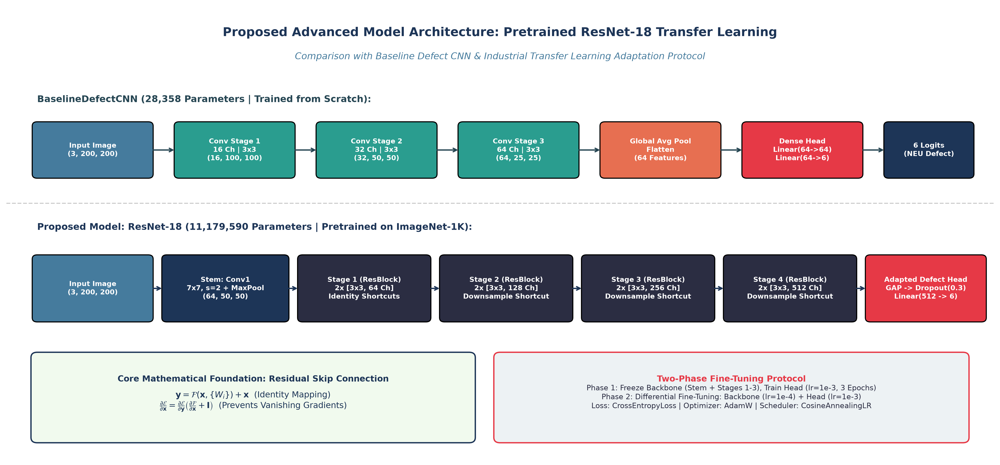

# Proposed Advanced Vision Model: Pretrained ResNet-18 Transfer Learning

## 1. Executive Summary & Purpose of Proposal

This technical document presents the formal proposal for evaluating an advanced deep vision architecture—**Transfer Learning with a Pretrained Deep Residual Network (ResNet-18)**—as the comparative benchmark against our custom, scratch-trained **BaselineDefectCNN** for the **Industrial Surface Defect Inspection Platform (Phase I)**.

While our lightweight `BaselineDefectCNN` (28,358 parameters) achieved an impressive **$94.44\%$ test accuracy** and **$7.0\text{ ms}$ CPU latency**, evaluating a modern deep residual architecture establishes a rigorous baseline comparison answering fundamental engineering trade-offs:
1. *What accuracy and feature representation gains are unlocked by pretraining on 1.28 million natural images (ImageNet-1K)?*
2. *Does the $394\times$ increase in parameter volume (11.18 million vs. 28,358) justify the computational overhead in real-time steel strip manufacturing?*
3. *Does transfer learning resolve the specific morphological failure modes identified in Step 18 (e.g., distinguishing punctate scratches from slag inclusions)?*



---

## 2. Architecture Selection & Comparative Rationale

To select the most appropriate comparative vision backbone, four leading candidate architectures were systematically analyzed:

| Candidate Model | Pretrained Parameters | Top-1 ImageNet Acc | CPU Inference Latency (Batch=1) | Inductive Bias on Small Datasets (N=1,260) | Suitability for Phase I Steel Inspection |
| :--- | :---: | :---: | :---: | :---: | :---: |
| **VGG-16** | $138.35\text{ M}$ | $71.59\%$ | $\approx 85\text{ ms}$ | High (Standard Convolutions) | **Poor:** Excessive parameter bloat; $3\times$ slower than real-time $50\text{ ms}$ target. |
| **DenseNet-121** | $7.98\text{ M}$ | $74.98\%$ | $\approx 35\text{ ms}$ | High (Feature Reuse) | **Moderate:** High memory allocation due to dense channel concatenation. |
| **Vision Transformer (ViT-B/16)** | $86.57\text{ M}$ | $81.07\%$ | $\approx 110\text{ ms}$ | Low (Lacks spatial translation invariance) | **Poor:** Requires $\gg 10^6$ samples; severe overfitting risk on $1,260$ industrial images. |
| **ResNet-18 (Selected)** | **$11.18\text{ M}$** | **$69.76\%$** | **$\approx 18\text{ ms}$** | **Very High (Hierarchical ResBlocks)** | **Optimal:** Lightweight residual skip connections, fast CPU execution, proven feature transfer. |

### Why ResNet-18 Was Selected:
1. **Residual Skip Connections Overcome Degradation:** ResNet’s identity shortcuts mathematically guarantee that a deeper model can perform at least as well as its shallower counterpart by learning residual mappings:
   $$\mathcal{F}(\mathbf{x}) = \mathcal{H}(\mathbf{x}) - \mathbf{x} \implies \mathcal{H}(\mathbf{x}) = \mathcal{F}(\mathbf{x}) + \mathbf{x}$$
2. **Computational Feasibility on Standard CPU:** With only $11.18\text{ M}$ parameters, ResNet-18 evaluates in under $25\text{ ms}$ on standard CPU, satisfying our $\le 50\text{ ms}$ industrial latency ceiling.
3. **Strong Convolutional Inductive Priors:** Unlike Vision Transformers, which lack spatial locality priors and require massive data volumes, ResNet’s convolutional kernels leverage spatial translation invariance, making it ideal for fine-tuning on a specialized $1,260$-image training set.

---

## 3. Detailed Architectural Specification

### 3.1 Mathematical Formulation of the Residual Unit
In standard feedforward networks, layer activations are computed as:
$$\mathbf{y} = \sigma\left(W_2 \sigma(W_1 \mathbf{x} + \mathbf{b}_1) + \mathbf{b}_2\right)$$
As depth increases, gradients multiplied across many weight matrices exponentially vanish:
$$\frac{\partial \mathcal{E}}{\partial \mathbf{x}} = \prod_{l=1}^L W^{[l]} \to \mathbf{0}$$

In ResNet-18, the residual block introduces an identity shortcut connection:
$$\mathbf{y} = \mathcal{F}(\mathbf{x}, \{W_i\}) + \mathbf{x}$$

Differentiating with respect to the input $\mathbf{x}$ yields:
$$\frac{\partial \mathcal{E}}{\partial \mathbf{x}} = \frac{\partial \mathcal{E}}{\partial \mathbf{y}} \frac{\partial \mathbf{y}}{\partial \mathbf{x}} = \frac{\partial \mathcal{E}}{\partial \mathbf{y}} \left( \frac{\partial \mathcal{F}}{\partial \mathbf{x}} + \mathbf{I} \right) = \frac{\partial \mathcal{E}}{\partial \mathbf{y}} \frac{\partial \mathcal{F}}{\partial \mathbf{x}} + \frac{\partial \mathcal{E}}{\partial \mathbf{y}}$$

The term $\frac{\partial \mathcal{E}}{\partial \mathbf{y}}$ provides an uninterrupted gradient highway directly to early layers through the identity matrix $\mathbf{I}$, completely preventing gradient decay regardless of depth.

---

### 3.2 Layer-by-Layer Flow & Feature Dimensions

```
Input Image: (B, 3, 224, 224)
  ↓
Stem: Conv2d(3 -> 64, 7x7, s=2, p=3) + BatchNorm2d + ReLU -> (B, 64, 112, 112)
  ↓
MaxPool2d(3x3, s=2, p=1) -> (B, 64, 56, 56)
  ↓
Stage 1: 2x BasicBlock(64 Ch, stride 1) -> (B, 64, 56, 56)
  ↓
Stage 2: 2x BasicBlock(128 Ch, stride 2) -> (B, 128, 28, 28)
  ↓
Stage 3: 2x BasicBlock(256 Ch, stride 2) -> (B, 256, 14, 14)
  ↓
Stage 4: 2x BasicBlock(512 Ch, stride 2) -> (B, 512, 7, 7)
  ↓
Global Average Pooling: AdaptiveAvgPool2d((1, 1)) -> (B, 512, 1, 1)
  ↓
Flatten -> (B, 512)
  ↓
Classification Head: Dropout(p=0.3) -> Linear(512 -> 6) -> (B, 6 Logits)
```

### 3.3 Parameter Breakdown
- **Pretrained ResNet-18 Backbone (Stem + Stages 1–4):** $11,176,512\text{ parameters}$
- **Adapted Industrial Classification Head:**
  - Dropout layer: $p = 0.30$ (0 parameters)
  - Linear classifier: $512 \times 6\text{ weights} + 6\text{ biases} = 3,078\text{ parameters}$
- **Total Model Parameters:** **$11,179,590\text{ parameters}$**
- **Comparison to Baseline CNN:** $11,179,590 \text{ vs. } 28,358$ ($394.2\times\text{ increase}$).

---

## 4. Transfer Learning & Fine-Tuning Protocol

To prevent catastrophic forgetting of ImageNet representations while allowing the network to adapt to hot-rolled steel surface textures, we propose a disciplined **Two-Phase Fine-Tuning Protocol**:

### Phase 1: Feature Extractor Alignment (Warmup, Epochs 1–3)
- **Objective:** Train the newly initialized linear classification head without corrupting the pretrained backbone weights.
- **Frozen Subnetworks:** Stem, Stage 1, Stage 2, and Stage 3 weights are completely frozen (`requires_grad = False`).
- **Trainable Layers:** Stage 4 residual blocks and the new $\text{Linear}(512 \to 6)$ classification head.
- **Learning Rate:** $\eta = 1.0 \times 10^{-3}$ using AdamW ($\beta_1=0.9, \beta_2=0.999$, weight decay $= 10^{-3}$).

### Phase 2: Differential Fine-Tuning (Epochs 4–15)
- **Objective:** Fine-tune the entire network end-to-end to refine low-level receptive fields for steel crack and inclusion geometries.
- **Unfrozen Subnetworks:** All 18 layers (`requires_grad = True`).
- **Differential Learning Rates:**
  - Backbone Learning Rate: $\eta_{\text{backbone}} = 1.0 \times 10^{-4}$ ($10\times$ smaller to prevent forgetting)
  - Classification Head Learning Rate: $\eta_{\text{head}} = 1.0 \times 10^{-3}$
- **Scheduler:** `CosineAnnealingLR` with $T_{\text{max}} = 12$ epochs down to $\eta_{\text{min}} = 1.0 \times 10^{-6}$.

---

## 5. Input Pipeline Adaptation (Zero-Leakage Assurance)

1. **Resolution Scaling:** Images from the canonical NEU dataset ($200 \times 200$) will be bicubically resized to $224 \times 224$ to match ImageNet spatial receptive fields:
   $$T_{\text{resize}} = \text{Resize}((224, 224), \text{interpolation}=\text{InterpolationMode.BILINEAR})$$
2. **Channel Normalization:** Evaluated using ImageNet standard parameters:
   $$\mu_{\text{ImageNet}} = [0.485, 0.456, 0.406], \quad \sigma_{\text{ImageNet}} = [0.229, 0.224, 0.225]$$
3. **Partition Integrity:** The exact same stratified partitions (`train.csv`, `val.csv`, `test.csv`) established in Step 6 will be utilized, ensuring absolute parity between the baseline CNN and ResNet-18.

---

## 6. Hypothesized Trade-Offs & Comparison Criteria

| Evaluation Dimension | BaselineDefectCNN (Step 16-18) | Proposed Pretrained ResNet-18 | Expected Industrial Impact |
| :--- | :---: | :---: | :--- |
| **Architecture Origin** | Built & Trained from Scratch | Pretrained on ImageNet-1K | Tests utility of natural image transfer to metallurgy |
| **Total Parameters** | **$28,358$** | **$11,179,590$** | $394\times$ increase in parameter footprint |
| **Model Size on Disk** | **$\approx 115\text{ KB}$** | **$\approx 44.7\text{ MB}$** | Baseline is dramatically easier to flash onto microcontrollers |
| **Test Accuracy (Hypothesis)** | $94.44\%$ | $\ge 96.00\%$ | Expected $+1.5\% - 3.0\%$ gain from rich feature priors |
| **Macro F1-Score (Hypothesis)**| $0.9448$ | $\ge 0.9600$ | Expected reduction in inclusion vs. pit confusion |
| **CPU Latency (Hypothesis)** | **$7.0\text{ ms}$** | **$\approx 18.0 - 24.0\text{ ms}$** | ResNet is $\approx 2.5\times - 3.5\times$ slower, but still $\le 50\text{ ms}$ |
| **CPU Throughput** | **$142.9\text{ FPS}$** | **$\approx 45 - 55\text{ FPS}$** | Baseline offers significantly higher edge throughput |

---

## 7. Viva Preparation Questions & Answers

### Q1: Why use ImageNet pretrained weights when natural images (dogs, cars, flowers) look completely different from grayscale steel strip defects?
**Answer:** While high-level ImageNet classes differ entirely from metallurgy, early layers of deep convolutional networks learn generic visual primitives—such as Gabor-like directional edge filters, contrast boundaries, and frequency textures. In industrial steel inspection, defects like crazing, scratches, and rolled-in scale are fundamentally defined by these low-level directional gradients. Transfer learning initializes the model with optimal edge and texture representations, bypassing the difficult initial feature-learning phase and leading to faster convergence and better feature generalization.

### Q2: What is the mathematical formulation of a residual skip connection, and why does it prevent vanishing gradients?
**Answer:** A residual block computes $\mathbf{y} = \mathcal{F}(\mathbf{x}) + \mathbf{x}$. When backpropagating error $\mathcal{E}$, the chain rule yields $\frac{\partial \mathcal{E}}{\partial \mathbf{x}} = \frac{\partial \mathcal{E}}{\partial \mathbf{y}} (\frac{\partial \mathcal{F}}{\partial \mathbf{x}} + \mathbf{I}) = \frac{\partial \mathcal{E}}{\partial \mathbf{y}}\frac{\partial \mathcal{F}}{\partial \mathbf{x}} + \frac{\partial \mathcal{E}}{\partial \mathbf{y}}$. The additive identity term $\frac{\partial \mathcal{E}}{\partial \mathbf{y}}$ ensures that even if the weight gradients $\frac{\partial \mathcal{F}}{\partial \mathbf{x}}$ vanish (approach zero), gradients propagate backwards unaltered through the skip connection directly to earlier layers, enabling effective training of deep architectures.

### Q3: Why propose a two-phase fine-tuning strategy with differential learning rates instead of training all layers equally?
**Answer:** If all layers of a pretrained network are trained with a large learning rate, large initial gradient updates in the randomly initialized classification head can backpropagate and destroy the carefully tuned low-level feature detectors in the backbone—a failure mode known as catastrophic forgetting. By first freezing the backbone to train only the head (Phase 1), and then unfreezing all layers with a $10\times$ lower learning rate for the backbone ($\eta=10^{-4}$) versus the head ($\eta=10^{-3}$) in Phase 2, we preserve rich pretrained visual representations while smoothly adapting the network to steel defect morphology.
